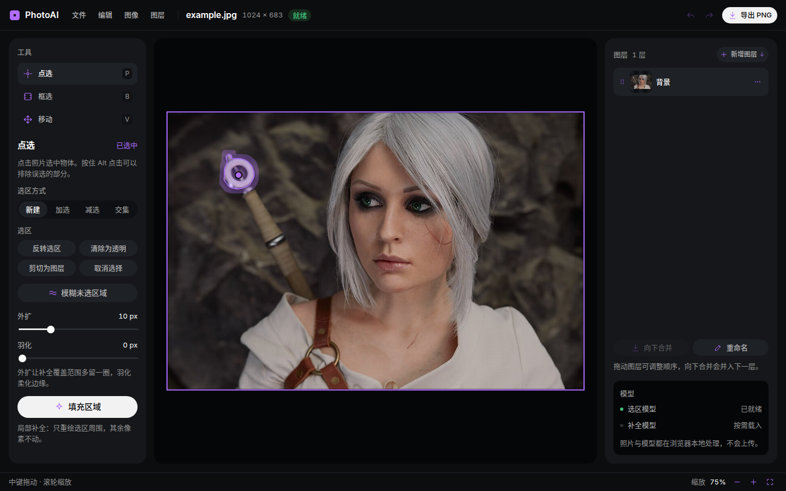

# PhotoAI

PhotoAI is a photo object editor that runs entirely in the browser. Click or box
an object in the frame and MobileSAM produces a mask; the mask can be inverted,
erased, cut into a layer, or filled locally or across the whole image with LaMa.
All inference runs on MNN/wasm inside a Web Worker, so photos are never uploaded
to a server.



## Features

- **Point / box prompts**: positive points, negative points and rectangles, with
  new, add, subtract and intersect modes.
- **Layer editing**: add image or solid-colour layers, drag to reorder, merge
  down, rename, export PNG.
- **Selection operations**: invert, erase to transparent, cut into a layer, crop
  to the selection.
- **Local inpainting**: crop a square around the selection's bounding box and
  send it to LaMa, preserving native detail on small objects; large selections
  fall back to the full-image path.
- **Blur unselected area**: live preview with adjustable expand, feather and blur
  strength; undoable after confirmation.
- **Fully local inference**: MobileSAM + LaMa compiled from C++ to wasm; models
  load on demand from static files.
- **English and Simplified Chinese**: switch languages from the Language menu;
  the choice is remembered in the browser.

## Stack

- Front end: Vue 3, TypeScript, Naive UI, SortableJS, Vite, vue-i18n
- Inference: MNN 3.6.2, Emscripten, MobileSAM, LaMa
- Model tooling: PyTorch → ONNX → MNN (`tools/`)

## Getting started

Requirements: Node.js 22.18+ or 24.12+, Git, Emscripten (default
`/usr/lib/emscripten`), CMake (for the MNN archive) and Python 3 with venv
(for model conversion).

```bash
git clone --recurse-submodules <repo-url> PhotoAI
cd PhotoAI
npm install

# Build the Emscripten MNN archive (once) and the wasm core.
./tools/build-mnn-wasm.sh
npm run wasm

# Download and convert the runtime models into public/models/ (once).
python3 -m venv .venv  # or `uv venv`.
. .venv/bin/activate
pip install -r tools/requirements.txt
./tools/convert.sh

# Run the dev server.
npm run dev
```

The page must be served over HTTP (Workers and wasm are unavailable under
`file://`).

## Build and deploy

```bash
npm run build      # type check + Vite build
npm run preview    # preview dist/ locally
npm run build:all  # rebuild wasm, then build the front end
```

## Layout

```
.
├── Makefile                    # wasm build (make / make test)
├── external/MNN/               # git submodule pinned to tag 3.6.2
├── native/
│   ├── photo_ai.cpp            # wasm core: models, composite, mask, fill
│   ├── third_party/            # stb_image_resize2.h
│   └── lib/wasm_simd/          # Emscripten MNN archive (generated, gitignored)
├── public/
│   ├── models/                 # runtime MNN models (copied into dist/models on build)
│   └── photo_ai.{js,wasm}      # wasm build output
├── src/                        # Vue 3 + TypeScript front end
│   ├── assets/fonts/           # self-hosted Inter (variable woff2 + @font-face css)
│   ├── components/
│   ├── editor/
│   ├── i18n/                   # locale registry and en / zh-Hans messages
│   ├── types/
│   └── worker.ts               # background inference thread
├── tools/                      # model conversion and build scripts
│   └── third_party/MobileSAM/  # git submodule (ChaoningZhang/MobileSAM)
├── test/                       # numerical parity checks and frozen fixtures
└── docs/
```

## Models

| File                            | Input → output                                                                                            | Size    |
| ------------------------------- | --------------------------------------------------------------------------------------------------------- | ------- |
| `public/models/sam_encoder.mnn` | `image [1,3,1024,1024]` → `image_embeddings [1,256,64,64]`                                                | ~27 MB  |
| `public/models/sam_decoder.mnn` | embeddings, `point_coords [1,N,2]`, `point_labels [1,N]` → `masks [1,4,256,256]`, `iou_predictions [1,4]` | ~24 MB  |
| `public/models/lama.mnn`        | `image_mask [1,4,512,512]` → `inpainted [1,3,512,512]`                                                    | ~197 MB |

Regenerate them from the upstream weights:

```bash
python3 -m venv .venv
. .venv/bin/activate
pip install -r tools/requirements.txt
./tools/convert.sh            # download weights, export ONNX, build MNNConvert, write public/models
./tools/convert.sh sam        # convert MobileSAM only
./tools/convert.sh lama 1024  # optional: 1024x1024 LaMa
```

LaMa's FFC frequency path has no usable 2D DFT operator in MNN 3.6.2, so the
export script rewrites it as a separable real DFT (cos/sin matrices + MatMul).
The model is therefore fixed to a single spatial size. See
[tools/README.md](tools/README.md) for details.

## Development

```bash
npm run type-check   # vue-tsc
npm run wasm -- test # build the Node wasm for numerical tests
```

Numerical parity (`npm test` runs the parity step):

```bash
python test/prep.py
node test/parity.mjs
python test/compare.py
```

Reference results: SAM mask IoU 0.9999, LaMa full-image max error 3/255.

## Acknowledgements

[MNN](https://github.com/alibaba/MNN), [MobileSAM](https://github.com/ChaoningZhang/MobileSAM),
[LaMa](https://github.com/advimman/lama), [Vue](https://vuejs.org/),
[Naive UI](https://www.naiveui.com/), [Vite](https://vite.dev/).

Third-party components keep their own licenses; see
[THIRD_PARTY_NOTICES.md](THIRD_PARTY_NOTICES.md) for the full list.

### Screenshot image

The documentation screenshot (`docs/screenshot.png`) uses
["Christmas table (Serbian cuisine)"](<https://commons.wikimedia.org/wiki/File:Christmas_table_(Serbian_cuisine).jpg>)
by Petar Milošević, licensed under
[CC BY-SA 4.0](https://creativecommons.org/licenses/by-sa/4.0/). The source JPEG
is kept at `test/data/example.jpg` for regenerating the screenshot.

## License

PhotoAI is licensed under the
[Apache License, Version 2.0](https://www.apache.org/licenses/LICENSE-2.0).
See [LICENSE](LICENSE) and [NOTICE](NOTICE).

Third-party software and assets keep their own licenses; the complete list and
license texts are in [THIRD_PARTY_NOTICES.md](THIRD_PARTY_NOTICES.md). In
particular:

- `docs/screenshot.png` and `test/data/example.jpg` are distributed under
  [CC BY-SA 4.0](https://creativecommons.org/licenses/by-sa/4.0/), not
  Apache-2.0, and retain the attribution to Petar Milošević.
- The Inter font in `src/assets/fonts/` is distributed under the
  [SIL Open Font License 1.1](src/assets/fonts/OFL.txt).
- The converted models in `public/models/` remain subject to the upstream
  MobileSAM and LaMa checkpoint terms described in
  [THIRD_PARTY_NOTICES.md](THIRD_PARTY_NOTICES.md).
